# Modelo de base de datos: Sistema de Gestión Hospitalaria Inteligente

**Hospital Susana López de Valencia (Popayán) · Hackathon Campus Party FUP 2026**
Versión 0.5 · 23 de septiembre de 2026 · Alineado con el levante de requerimientos v0.5.

**Cambios frente a la versión 0.4** (por el perfil de los txt reales):
- `core.triages.triage_level`: nivel 1 a 5 extraído de `ClasificacionTriage`. Las vistas del agente usan `triage_level` en lugar de `triage_code`.
- `core.app_settings` y `agent.reference_date()`: la fecha de referencia vive en la base.
- `core.mv_item_catalog`: catálogo de ítems con `item_type` (medicamento o dispositivo); `v_drug_inventory` y `v_drug_consumption_daily` lo exponen.
- `mv_admission_stay`: el egreso estimado se recorta con la siguiente asignación de la misma cama y nunca queda antes de la propia asignación.
- `surgery_schedules`: `patient_id` y `admission_id` pasan a referencias lógicas; `v_surgeries` solo incluye programaciones con ingreso en el extracto.
- `admissions.triage_id` queda nulo si el triage no existe; los nombres de servicio con errores de digitación se corrigen al transformar.
- El staging del HIS se vacía después de aplicar la carga histórica.

Este documento es la referencia del modelo lógico-físico mientras no exista `schema.sql`. Cuando exista, `schema.sql` pasa a ser la fuente de verdad y este documento queda como documentación.

---

## 1. Convenciones

- Motor: PostgreSQL (Supabase).
- Nombres de tablas y columnas en inglés, en `snake_case`. En el diagrama Mermaid el prefijo indica el esquema (`core_admissions` = `core.admissions`).
- **PK**: llave primaria. **FK**: llave foránea física. **Ref. lógica**: la columna apunta a otra tabla, pero sin llave foránea obligatoria.
- **Nulo**: "Sí" si la columna acepta NULL.
- **Origen HIS**: columna de DateBaseHIS de la que sale el dato. "—" si el dato no viene del HIS.
- Toda tabla de `core` que recibe datos lleva `batch_id` (FK a `audit.import_batches`) para trazar el lote de origen.
- `data_origin` marca la procedencia de los datos complementarios: `historical`, `derived`, `imported` o `simulated` (RNF-09).
- Fechas del HIS: `timestamp` sin zona, en hora de Colombia (S-12). Fechas de auditoría: `timestamptz`.
- Formato de origen confirmado: UTF-8 con BOM, separador `|`, fechas `AAAA-MM-DD HH:MM:SS`.

## 2. Esquemas y roles

| Esquema | Propósito | Quién accede |
|---|---|---|
| `auth` | Cuentas y contraseñas. Lo administra Supabase Auth. | Supabase Auth; el backend usa la service role key solo en el servidor. |
| `staging` | Copia fiel de los archivos de origen, todo como texto, antes de validar. | Rol `importer` (solo inserción) y script de carga histórica. |
| `core` | Datos limpios y tipados, tablas complementarias, configuración (`app_settings`), vistas materializadas y perfiles de usuario. | Rol `app_backend` y función `core.apply_batch`. |
| `agent` | Vistas anonimizadas y la función `agent.reference_date()`. Único esquema que ve la IA y único expuesto en la Data API. | Rol `agent_ro` y consultas fijas del dashboard. |
| `audit` | Lotes de carga, errores, log de consultas y log de administración de usuarios. | Rol `app_backend`; `importer` solo en lotes y errores. |

| Rol de Postgres | Permisos | Lo usa |
|---|---|---|
| `agent_ro` | Solo SELECT sobre `agent` y EXECUTE sobre `agent.reference_date()`; transacciones de solo lectura; `statement_timeout` de 5 s. | POST /api/query |
| `importer` | INSERT en `staging`, `audit.import_batches` y `audit.import_errors`; EXECUTE sobre `core.apply_batch`. | POST /api/import |
| `app_backend` | SELECT sobre `core` y `agent`; escritura en `core.user_profiles`, `audit.query_log` y `audit.user_admin_log`. | Sesión, administración de usuarios, logs y consultas fijas |

## 3. Esquema `auth`

### auth.users
Tabla administrada por Supabase Auth. La aplicación no la crea ni escribe en ella directamente; solo se referencia.

| Columna | Tipo | Llave | Nulo | Descripción |
|---|---|---|---|---|
| id | uuid | PK | No | Identificador de la cuenta. |
| email | text | — | No | Correo de inicio de sesión. |
| encrypted_password | text | — | No | Hash de la contraseña, gestionado por Supabase. |
| last_sign_in_at | timestamptz | — | Sí | Último inicio de sesión. |

## 4. Esquema `core`: usuarios

### core.user_profiles
Una ficha por cuenta, con el rol y el estado. Relación 1:1 con `auth.users`.

| Columna | Tipo | Llave | Nulo | Descripción |
|---|---|---|---|---|
| user_id | uuid | PK, FK → auth.users.id | No | Mismo id de la cuenta en Supabase Auth. |
| full_name | text | — | No | Nombre de la persona. |
| role | text | — | No | `director`, `service_head`, `medic` o `admin` (CHECK). |
| is_active | boolean | — | No | Por defecto `true`. El servidor lo verifica en cada request (AUT-05). |
| must_change_password | boolean | — | No | Por defecto `true`. Obliga a cambiar la contraseña en el primer ingreso (AUT-10). |
| created_by | uuid | FK → core.user_profiles.user_id | Sí | Administrador que creó la cuenta. Nulo para el admin inicial del script. |
| created_at | timestamptz | — | No | Por defecto `now()`. |
| updated_at | timestamptz | — | No | Por defecto `now()`. |

La matriz de permisos no vive en la base: está en `/lib/auth/permissions.ts`. La base solo guarda el rol.

## 5. Esquema `audit`

### audit.import_batches
Un registro por cada carga de datos (script histórico, importador o semilla sintética).

| Columna | Tipo | Llave | Nulo | Descripción |
|---|---|---|---|---|
| batch_id | uuid | PK | No | Por defecto `gen_random_uuid()`. |
| load_type | text | — | No | `historical`, `ui_import` o `seed_synthetic` (CHECK). `seed_synthetic` se usa para la foto simulada de `drug_stock` (CAR-03). |
| target_table | text | — | No | Tabla de destino (`drug_stock`, `bed_inventory`, `surgery_schedules`, `admissions`, etc.). |
| file_name | text | — | Sí | Nombre del archivo cargado. |
| source_system | text | — | No | Área o sistema de origen (Farmacia, Admisiones, HIS…). |
| imported_by_user_id | uuid | FK → core.user_profiles.user_id | Sí | Usuario que importó. Obligatorio cuando `load_type = 'ui_import'` (CHECK). |
| imported_at | timestamptz | — | No | Por defecto `now()`. |
| rows_read | int | — | No | Filas leídas del archivo. |
| rows_loaded | int | — | No | Filas que pasaron a `core`. |
| rows_rejected | int | — | No | Filas rechazadas por validación. |
| status | text | — | No | `pending`, `validated`, `applied`, `rejected` o `reverted` (CHECK). `rejected`: el lote tenía filas inválidas o una foto de inventario repetida y no se aplicó nada. |
| is_simulated | boolean | — | No | `true` si el lote contiene datos simulados. |

### audit.import_errors
Errores de validación por fila y columna (IMP-04, CAR-05).

| Columna | Tipo | Llave | Nulo | Descripción |
|---|---|---|---|---|
| error_id | bigint | PK (identity) | No | Identificador del error. |
| batch_id | uuid | FK → audit.import_batches.batch_id | No | Lote al que pertenece. |
| row_number | int | — | No | Número de fila en el archivo de origen. |
| column_name | text | — | Sí | Columna con el error; nulo si el error es de la fila completa. |
| error_message | text | — | No | Descripción del error. |

### audit.query_log
Una fila por pregunta al agente. No guarda las filas devueltas (SEG-06).

| Columna | Tipo | Llave | Nulo | Descripción |
|---|---|---|---|---|
| query_log_id | bigint | PK (identity) | No | Identificador del registro. |
| user_id | uuid | FK → core.user_profiles.user_id | No | Usuario que preguntó. |
| asked_at | timestamptz | — | No | Por defecto `now()`. |
| question | text | — | No | Pregunta en lenguaje natural. |
| generated_sql | text | — | Sí | SQL generado o SQL predefinido del plan B. |
| origin | text | — | No | `llm` o `predefined` (CHECK). |
| llm_provider | text | — | Sí | `gemini` o `groq`; nulo si respondió el plan B. |
| status | text | — | No | `ok`, `rejected` (validación o pregunta sensible) o `error` (CHECK). |
| error_message | text | — | Sí | Detalle del rechazo o error. Si falló el LLM o su SQL y respondió el plan B, guarda la causa del fallo. |
| row_count | int | — | Sí | Número de filas devueltas. |
| duration_ms | int | — | No | Tiempo total de respuesta. |

### audit.user_admin_log
Registro de cada acción de administración sobre cuentas (AUT-11).

| Columna | Tipo | Llave | Nulo | Descripción |
|---|---|---|---|---|
| admin_log_id | bigint | PK (identity) | No | Identificador del registro. |
| actor_user_id | uuid | FK → core.user_profiles.user_id | No | Quién hizo la acción. |
| target_user_id | uuid | FK → core.user_profiles.user_id | No | Cuenta afectada. |
| action | text | — | No | `create`, `role_change`, `deactivate`, `reactivate` o `password_reset` (CHECK). |
| old_value | text | — | Sí | Valor anterior (por ejemplo, el rol previo). |
| new_value | text | — | Sí | Valor nuevo. |
| created_at | timestamptz | — | No | Por defecto `now()`. |

## 6. Esquema `staging`

Diez tablas: una por cada tabla del HIS y una por cada plantilla del importador. Todas sus columnas de datos son `text` para que la carga nunca falle por formato; la validación y el casteo se hacen después.

**Columnas comunes a todas las tablas de staging** (en el diagrama aparecen resumidas en dos bloques):

| Columna | Tipo | Llave | Nulo | Descripción |
|---|---|---|---|---|
| batch_id | uuid | FK → audit.import_batches.batch_id | No | Lote de carga. |
| source_row_number | int | — | No | Número de fila en el archivo original. |
| loaded_at | timestamptz | — | No | Por defecto `now()`. |
| validation_status | text | — | No | `pending`, `valid` o `invalid` (CHECK). |

| Tabla | Columnas de datos (todas `text`) |
|---|---|
| staging.stg_paciente | Las 10 columnas de Paciente del diccionario HIS. |
| staging.stg_ingresos | Las 15 columnas de Ingresos. |
| staging.stg_triage | Las 10 columnas de Triage. |
| staging.stg_atencion | Las 2 columnas de Atencion. |
| staging.stg_servicios | Las 9 columnas de Servicios. |
| staging.stg_medicamento_insumo | Las 8 columnas de MedicamentoInsumo. |
| staging.stg_programacion_cirugia | Las 4 columnas de ProgramacionCirugia. |
| staging.stg_drug_stock | Plantilla de inventario: item_code, item_name, current_stock, unit, stock_date, expiration_date. |
| staging.stg_bed_inventory | Plantilla de camas: bed_code, bed_name, bed_group, bed_subgroup, is_active. |
| staging.stg_surgery_schedule | Plantilla quirúrgica: schedule_number, patient_id, admission_id, service_code, scheduled_date, operating_room. |

Después de aplicar la carga histórica, las 7 tablas del HIS en staging se vacían (CAR-07); las de las plantillas se conservan para trazar las importaciones. La carga histórica valida que las filas leídas coincidan con las del origen (Triage: 17.781).

El paso de staging a `core` lo hace `core.apply_batch(batch_id)`, con SECURITY DEFINER. Aplica todo o nada: si el lote tiene alguna fila `invalid` o, para `drug_stock`, alguna combinación (`item_code`, `stock_date`) que ya existe, marca el lote como `rejected` y no toca `core` (IMP-05, SEG-12). Si todo es válido, castea, inserta con `ON CONFLICT` (idempotencia de la carga histórica), marca el lote como `applied` y refresca las vistas materializadas.

## 7. Esquema `core`: datos del HIS

### core.patients
Un registro por paciente. `NombrePaciente` no se carga (minimización de datos).

| Columna | Tipo | Llave | Nulo | Origen HIS | Descripción |
|---|---|---|---|---|---|
| patient_id | int | PK | No | Paciente.IdPaciente | Id del paciente en el HIS. Nunca se expone al agente. |
| document_type | text | — | No | Paciente.TipoDocumento | Sensible: fuera de las vistas del agente. |
| birth_date | date | — | No | Paciente.FechaNacimiento | Se expone al agente solo como `age_group`. |
| sex | text | — | No | Paciente.Sexo | Masculino / Femenino. |
| insurer | text | — | No | Paciente.Asegurador | EPS o ARL. |
| regime | text | — | No | Paciente.Regimen | Régimen de afiliación. |
| department | text | — | No | Paciente.Departamento | Departamento de residencia. |
| municipality | text | — | No | Paciente.Municipio | Municipio de residencia. |
| zone | text | — | No | Paciente.Zona | Urbana / Rural. |
| batch_id | uuid | FK → audit.import_batches | No | — | Lote de origen. |

### core.admissions
Tabla central: cada fila es un episodio de atención.

| Columna | Tipo | Llave | Nulo | Origen HIS | Descripción |
|---|---|---|---|---|---|
| admission_id | bigint | PK | No | Ingresos.OidIngreso | Id del ingreso. |
| admission_number | int | — | No | Ingresos.ConsecutivoIngreso | Consecutivo interno. |
| patient_id | int | FK → core.patients | No | Ingresos.IdPaciente | Paciente del ingreso. |
| admission_class | text | — | No | Ingresos.ClaseIngreso | Ambulatorio / Hospitalario (S-05). |
| admission_route | text | — | No | Ingresos.ViaIngreso | Vía de ingreso; define urgencias (S-04). |
| risk_type | text | — | No | Ingresos.TipoRiesgo | Origen del evento. |
| admitted_at | timestamp | — | No | Ingresos.FechaIngreso | Fecha y hora del ingreso. |
| hospitalized_at | timestamp | — | Sí | Ingresos.FechaHospitalizacion | Asignación de cama. La tienen también los ingresos ambulatorios (99,9 %), así que no indica hospitalización (S-05, S-08). |
| triage_id | bigint | FK → core.triages | Sí | Ingresos.OidTriageA | Triage asociado. Nulo si OidTriageA no existe en Triage; el caso se cuenta en el reporte de carga. |
| bed_code | text | Ref. lógica → core.bed_inventory | No | Ingresos.CodigoCama | Cama asignada. |
| bed_name | text | — | No | Ingresos.NombreCama | Nombre de la cama. |
| bed_group | text | — | No | Ingresos.NombreGrupoCama | Servicio (S-02), 9 valores. Texto normalizado para cruzar con `bed_inventory`; "GINECO OBSTRETICIA" se corrige a "GINECO OBSTETRICIA". |
| bed_subgroup | text | — | No | Ingresos.NombreSubgrupoCama | Subservicio, 19 valores. "UNIDAD DE CUIDAD BASICO NEONATAL" se corrige a "UNIDAD DE CUIDADO BASICO NEONATAL". |
| diagnosis_code | text | — | Sí | Ingresos.CodigoDiagnostico | CIE-10. Sensible: solo se expone agregado. |
| diagnosis_name | text | — | Sí | Ingresos.NombreDiagnostico | Sensible: solo se expone agregado. |
| batch_id | uuid | FK → audit.import_batches | No | — | Lote de origen. |

### core.triages
Clasificación de urgencia. El export trae una fila por ingreso; las 1.667 filas sin `OidTriage` (ingresos sin triage) se descartan y se registran en `audit.import_errors`.

| Columna | Tipo | Llave | Nulo | Origen HIS | Descripción |
|---|---|---|---|---|---|
| triage_id | bigint | PK | No | Triage.OidTriage | Id del triage. |
| patient_id | int | FK → core.patients | Sí | Triage.IdPaciente2 | Paciente clasificado. |
| triaged_at | timestamp | — | Sí | Triage.FechaTriage | Fecha y hora del triage. |
| triage_code | text | — | Sí | Triage.CodigoTriage | Código de consultorio y área (24 valores). No es el nivel de triage. |
| triage_level | smallint | — | Sí | Derivado de Triage.ClasificacionTriage | Nivel 1 a 5: el número que sigue a "TRIAGE" en el texto (S-16). CHECK entre 1 y 5; nulo si no se reconoce. |
| triage_classification | text | — | Sí | Triage.ClasificacionTriage | Consultorio, área y nivel, por ejemplo "GINECOLOGIA URGENCIA - TRIAGE 2". |
| chief_complaint | text | — | Sí | Triage.MotivoConsulta | Sensible: fuera de las vistas del agente. |
| blood_pressure | text | — | Sí | Triage.TensionArterial | Se deja como texto (formato "120/80"). |
| heart_rate | int | — | Sí | Triage.FrecuenciaCardiaca | Casteo tolerante: NULL si no es numérico. |
| respiratory_rate | int | — | Sí | Triage.FrecuenciaRespiratoria | Casteo tolerante. |
| temperature | numeric(4,1) | — | Sí | Triage.Temperatura | Grados Celsius; casteo tolerante. |
| batch_id | uuid | FK → audit.import_batches | No | — | Lote de origen. |

### core.first_attentions
Primera atención médica de cada ingreso. No todos los ingresos la tienen.

| Columna | Tipo | Llave | Nulo | Origen HIS | Descripción |
|---|---|---|---|---|---|
| admission_id | bigint | PK, FK → core.admissions | No | Atencion.OidIngreso | Ingreso atendido. |
| attended_at | timestamp | — | No | Atencion.FechaAtencion | Fecha y hora de la primera atención. |
| batch_id | uuid | FK → audit.import_batches | No | — | Lote de origen. |

### core.service_lines
Servicios y procedimientos prestados (~582.000 filas).

| Columna | Tipo | Llave | Nulo | Origen HIS | Descripción |
|---|---|---|---|---|---|
| service_line_id | bigint | PK | No | Servicios.OidS | Id de la línea de servicio. |
| admission_id | bigint | FK → core.admissions | No | Servicios.OidIngreso | Ingreso al que pertenece. |
| service_code | text | — | No | Servicios.CodigoServicio | Código CUPS. |
| service_name | text | — | No | Servicios.NombreServicio | Descripción del servicio. |
| quantity | int | — | No | Servicios.Cantidad | Unidades prestadas. |
| provided_at | timestamp | — | No | Servicios.FechaPrestacion | Fecha y hora de prestación. |
| area_code | text | — | No | Servicios.CodigoAreaServicio | Código del área. |
| area_name | text | — | No | Servicios.AreaServicio | Área que prestó el servicio. |
| specialty | text | — | No | Servicios.Especialidad | Especialidad que lo ordenó. |
| batch_id | uuid | FK → audit.import_batches | No | — | Lote de origen. |

### core.drug_dispensations
Medicamentos e insumos dispensados (~579.000 filas).

| Columna | Tipo | Llave | Nulo | Origen HIS | Descripción |
|---|---|---|---|---|---|
| dispensation_id | bigint | PK | No | MedicamentoInsumo.OidMI | Id de la dispensación. |
| admission_id | bigint | FK → core.admissions | No | MedicamentoInsumo.OidIngreso | Ingreso al que pertenece. |
| item_code | text | Ref. lógica → core.drug_stock | No | MedicamentoInsumo.CodigoServicio | Código del medicamento o insumo. |
| item_name | text | — | No | MedicamentoInsumo.NombreServicio | Descripción. |
| quantity | int | — | No | MedicamentoInsumo.Cantidad | Cantidad dispensada. |
| dispensed_at | timestamp | — | No | MedicamentoInsumo.FechaPrestacion | Fecha y hora de dispensación. |
| area_name | text | — | No | MedicamentoInsumo.AreaServicio | Área que dispensó. |
| specialty | text | — | No | MedicamentoInsumo.Especialidad | Especialidad que prescribió. |
| batch_id | uuid | FK → audit.import_batches | No | — | Lote de origen. |

### core.surgery_schedules
Cirugías programadas. Usa llave sustituta porque el origen no tiene llave primaria.

| Columna | Tipo | Llave | Nulo | Origen HIS | Descripción |
|---|---|---|---|---|---|
| surgery_schedule_id | bigint | PK (identity) | No | — | Llave sustituta. |
| schedule_number | text | — | No | ProgramacionCirugia.ConsecutivoProgramacion | Agrupa los servicios de una misma cirugía. |
| patient_id | int | Ref. lógica → core.patients | No | ProgramacionCirugia.IdPaciente | Paciente. Solo el 34,4 % existe en el extracto. |
| admission_id | bigint | Ref. lógica → core.admissions | Sí | ProgramacionCirugia.OidIngreso | Ingreso asociado. Vacío en el 18,4 % de las filas; de los que tienen valor, solo el 30,8 % existe en el extracto. |
| service_code | text | — | No | ProgramacionCirugia.CodigoServicio | Procedimiento programado. |
| scheduled_date | date | — | Sí | — | Solo si se importa la plantilla. |
| operating_room | text | — | Sí | — | Solo si se importa la plantilla. |
| data_origin | text | — | No | — | `historical` o `imported` (CHECK). |
| batch_id | uuid | FK → audit.import_batches | No | — | Lote de origen. |

Regla S-11: el universo son las programaciones (`schedule_number`) cuyo `admission_id` existe en `core.admissions`. Una programación es realizada si al menos una de sus filas tiene una línea en `core.service_lines` con el mismo `admission_id` y `service_code`. El mes es `scheduled_date` si se importó la plantilla o, si no, el mes de `admissions.admitted_at`.

## 8. Esquema `core`: tablas complementarias

### core.bed_inventory
Catálogo de camas y capacidad por servicio.

| Columna | Tipo | Llave | Nulo | Descripción |
|---|---|---|---|---|
| bed_code | text | PK | No | Código de la cama. |
| bed_name | text | — | No | Nombre de la cama. |
| bed_group | text | — | No | Servicio. Debe coincidir (normalizado) con `admissions.bed_group`. |
| bed_subgroup | text | — | No | Subservicio. |
| is_active | boolean | — | No | Si la cama cuenta para la capacidad. |
| data_origin | text | — | No | `derived` (camas vistas en el histórico), `imported` o `simulated` (CHECK). |
| batch_id | uuid | FK → audit.import_batches | No | Lote de origen. |

### core.drug_stock
Inventario de medicamentos como serie de fotos por fecha. La vista del agente usa la foto más reciente de cada medicamento.

| Columna | Tipo | Llave | Nulo | Descripción |
|---|---|---|---|---|
| drug_stock_id | bigint | PK (identity) | No | Identificador de la fila. |
| item_code | text | UNIQUE (item_code, stock_date) | No | Código del medicamento o insumo. |
| item_name | text | — | No | Descripción. |
| stock_date | date | — | No | Fecha de la foto del inventario. |
| current_stock | numeric | — | No | Existencias (CHECK ≥ 0). |
| unit | text | — | Sí | Unidad de medida. |
| expiration_date | date | — | Sí | Fecha de vencimiento. |
| data_origin | text | — | No | `imported` o `simulated` (CHECK). |
| batch_id | uuid | FK → audit.import_batches | No | Lote de origen. Revertir el lote borra la foto y vuelve a regir la anterior. |

### core.app_settings
Configuración de una sola fila. La escribe el script de carga con REFERENCE_DATE del .env (CAR-08).

| Columna | Tipo | Llave | Nulo | Descripción |
|---|---|---|---|---|
| id | boolean | PK | No | Siempre `true` (CHECK), para que exista una sola fila. |
| reference_date | date | — | No | Fecha de "hoy" para vistas, consultas fijas y SQL del LLM. Valor actual: 2026-09-21. |
| updated_at | timestamptz | — | No | Por defecto `now()`. |

`agent.reference_date()` es una función SQL `STABLE` con SECURITY DEFINER que devuelve `reference_date`. `agent_ro` puede ejecutarla, pero no leer `core.app_settings`.

## 9. Esquema `core`: vistas materializadas

Se refrescan al final de `core.apply_batch` y de la carga histórica con `REFRESH MATERIALIZED VIEW CONCURRENTLY`, que exige un índice único en cada una.

### core.mv_admission_stay
Egreso estimado y estancia de los ingresos con cama asignada (`hospitalized_at` no nulo: 17.774 de 17.781). Índice único: `admission_id`.

| Columna | Tipo | Descripción |
|---|---|---|
| admission_id | bigint | Ingreso. |
| bed_code | text | Cama asignada. |
| bed_group | text | Servicio. |
| bed_subgroup | text | Subservicio. |
| hospitalized_at | timestamp | Inicio de la hospitalización. |
| estimated_discharge_at | timestamp | Regla S-07: `GREATEST(hospitalized_at, LEAST(última prestación, siguiente asignación de la misma cama))`. La última prestación es el máximo entre `service_lines.provided_at` y `drug_dispensations.dispensed_at`; la siguiente asignación sale de `LEAD(hospitalized_at) OVER (PARTITION BY bed_code ORDER BY hospitalized_at)`. |
| stay_days | numeric | Días entre la asignación de cama y el egreso estimado; nunca negativo. |

### core.mv_bed_occupancy_daily
Ocupación por día y servicio. Índice único: `(day, bed_group, bed_subgroup)`.

| Columna | Tipo | Descripción |
|---|---|---|
| day | date | Día calculado. |
| bed_group | text | Servicio. |
| bed_subgroup | text | Subservicio. |
| occupied_beds | int | Camas distintas con estancia activa ese día (S-08). |
| capacity | int | Camas activas en `bed_inventory` para ese servicio y subservicio. |
| occupancy_pct | numeric | `occupied_beds ÷ capacity × 100`. |

### core.mv_item_catalog
Un registro por medicamento o insumo dispensado. Índice único: `item_code`.

| Columna | Tipo | Descripción |
|---|---|---|
| item_code | text | Código del ítem. |
| item_name | text | Nombre más reciente del ítem. |
| item_type | text | `medicamento` o `dispositivo`. Dispositivo si más de la mitad de sus dispensaciones viene de áreas cuyo nombre contiene "DISPOS" (S-15). |
| dispensation_rows | int | Número de dispensaciones del ítem en el histórico. |

## 10. Esquema `agent`: vistas anonimizadas

Reglas comunes:
- Se crean sin `security_invoker`, para que `agent_ro` lea la vista sin tener permisos sobre `core`.
- Las fechas relativas (edad, últimos 30 días) se calculan con `agent.reference_date()`, que el SQL del LLM también usa en lugar de CURRENT_DATE.
- Ninguna vista expone `triage_code`: el nivel de triage es `triage_level`.
- Ninguna vista expone nombre, documento, motivo de consulta, fecha de nacimiento, id real del paciente ni diagnóstico individual (SEG-03).
- `patient_key` es un hash con sal del `patient_id`. La sal se guarda en una tabla de `core` a la que `agent_ro` no tiene acceso, y el validador de SQL bloquea `pg_catalog` e `information_schema`.
- Sin permisos para `anon` ni `authenticated`; el servidor lee con la service role key o con `agent_ro`.

| Vista | Columnas | Fuente y lógica |
|---|---|---|
| agent.v_admissions | admission_id, patient_key, admission_class, admission_route, admitted_at, hospitalized_at, estimated_discharge_at, service, subservice, triage_level, age_group, sex, regime, zone | `admissions` + `mv_admission_stay` + `triages` + `patients`. `age_group` en rangos calculados desde `birth_date` a `agent.reference_date()`. Pregunta 4 de la demo (`admission_class = 'Hospitalario'`). |
| agent.v_bed_occupancy | day, service, subservice, occupied_beds, capacity, occupancy_pct, is_capacity_simulated | `mv_bed_occupancy_daily` + `bed_inventory.data_origin`. Pregunta 1 de la demo (`service = 'UNIDAD DE CUIDADO INTENSIVO'`) y alerta de ocupación por subservicio (ALE-02). |
| agent.v_emergency_wait_times | admission_id, admitted_at, triaged_at, attended_at, wait_minutes, triage_level, triage_classification, shift, weekday, hour | `admissions` (solo `admission_route = 'Urgencias'`) + `triages` + `first_attentions`. `wait_minutes` entre 0 y 1.440 (S-06); si no hay triage, se mide desde `admitted_at`. `shift` = día o noche. Pregunta 3 de la demo. |
| agent.v_drug_inventory | item_code, item_name, item_type, current_stock, avg_daily_consumption, days_of_inventory, stock_date, is_simulated | Foto más reciente de `drug_stock` + `mv_item_catalog` + consumo de los 30 días hasta `agent.reference_date()` de `drug_dispensations` ÷ 30 (S-10). `days_of_inventory = current_stock ÷ avg_daily_consumption`. Pregunta 2 de la demo. |
| agent.v_drug_consumption_daily | day, item_code, item_name, item_type, area_name, specialty, total_quantity | `drug_dispensations` + `mv_item_catalog`, agregado por día, ítem, área y especialidad. |
| agent.v_service_demand_daily | day, area_name, specialty, service_code, service_name, lines_count, total_quantity | `service_lines` agregado por día, área, especialidad y servicio. |
| agent.v_surgeries | schedule_number, scheduled_month, is_performed, data_origin | Una fila por programación, solo las que tienen ingreso en `admissions` (S-11). `is_performed` si alguno de sus servicios aparece en `service_lines` para ese ingreso. `scheduled_month` sale de `scheduled_date` o, si es nula, de `admissions.admitted_at`. |
| agent.v_diagnosis_monthly | month, service, diagnosis_code, diagnosis_name, admissions_count | `admissions` agregado por mes, servicio y diagnóstico, con `HAVING count(*) >= 5`. |

## 11. Relaciones

| Desde | Hacia | Cardinalidad | Tipo |
|---|---|---|---|
| auth.users.id | core.user_profiles.user_id | 1 : 1 | FK física |
| core.user_profiles.user_id | core.user_profiles.created_by | 1 : 0..N | FK física (recursiva) |
| core.user_profiles.user_id | audit.import_batches.imported_by_user_id | 0..1 : 0..N | FK física |
| core.user_profiles.user_id | audit.query_log.user_id | 1 : 0..N | FK física |
| core.user_profiles.user_id | audit.user_admin_log.actor_user_id | 1 : 0..N | FK física |
| core.user_profiles.user_id | audit.user_admin_log.target_user_id | 1 : 0..N | FK física |
| audit.import_batches.batch_id | audit.import_errors.batch_id | 1 : 0..N | FK física |
| audit.import_batches.batch_id | `batch_id` de todas las tablas de staging y core | 1 : 0..N | FK física |
| core.patients.patient_id | core.admissions.patient_id | 1 : 0..N | FK física |
| core.patients.patient_id | core.triages.patient_id | 1 : 0..N | FK física |
| core.patients.patient_id | core.surgery_schedules.patient_id | 0..1 : 0..N | Ref. lógica (65,6 % sin pareja en el extracto) |
| core.triages.triage_id | core.admissions.triage_id | 1 : 0..1 | FK física |
| core.admissions.admission_id | core.first_attentions.admission_id | 1 : 0..1 | FK física |
| core.admissions.admission_id | core.service_lines.admission_id | 1 : 0..N | FK física |
| core.admissions.admission_id | core.drug_dispensations.admission_id | 1 : 0..N | FK física |
| core.admissions.admission_id | core.surgery_schedules.admission_id | 0..1 : 0..N | Ref. lógica (69,2 % sin pareja en el extracto) |
| core.bed_inventory.bed_code | core.admissions.bed_code | 0..1 : 0..N | Ref. lógica |
| core.drug_stock.item_code | core.drug_dispensations.item_code | N : N (por fotos) | Ref. lógica |
| core.mv_item_catalog.item_code | core.drug_dispensations.item_code | 1 : 1..N | Derivada (vista materializada) |
| core.surgery_schedules (admission_id, service_code) | core.service_lines (admission_id, service_code) | 1 : 0..1 | Ref. lógica derivada (cirugía realizada) |

## 12. Índices recomendados

| Tabla | Índice | Para qué |
|---|---|---|
| core.admissions | (admitted_at), (hospitalized_at), (patient_id), (bed_group), (triage_id), (bed_code, hospitalized_at) | Filtros por fecha, conteo de pacientes, ocupación, joins y siguiente asignación de la misma cama (S-07). |
| core.triages | (triaged_at) | Tiempos de espera. |
| core.service_lines | (admission_id, provided_at), (admission_id, service_code), (provided_at) | Egreso estimado, cirugías realizadas y demanda. |
| core.drug_dispensations | (admission_id, dispensed_at), (item_code, dispensed_at) | Egreso estimado y consumo de 30 días. |
| core.drug_stock | UNIQUE (item_code, stock_date) | Foto más reciente por medicamento. |
| core.surgery_schedules | (admission_id, service_code), (schedule_number) | Cruce con servicios prestados y agrupación por programación. |
| core.mv_item_catalog | UNIQUE (item_code) | Requisito de `REFRESH ... CONCURRENTLY` y cruce con inventario. |
| Todas las tablas con `batch_id` | (batch_id) | Revertir un lote. |
| audit.query_log | (user_id, asked_at) | Consulta del log por usuario. |

## 13. Diagrama (Mermaid)

```mermaid
erDiagram
  auth_users {
    uuid id PK "gestionado por Supabase Auth"
    text email
    text encrypted_password "hash, nunca lo toca la app"
    timestamptz last_sign_in_at
  }
  core_user_profiles {
    uuid user_id PK "tambien FK a auth.users"
    text full_name
    text role "director / service_head / medic / admin"
    boolean is_active
    boolean must_change_password
    uuid created_by FK "a user_profiles, nullable"
    timestamptz created_at
    timestamptz updated_at
  }
  audit_user_admin_log {
    bigint admin_log_id PK
    uuid actor_user_id FK
    uuid target_user_id FK
    text action "create / role_change / deactivate / reactivate / password_reset"
    text old_value
    text new_value
    timestamptz created_at
  }
  staging_his_raw {
    text columnas_origen "7 tablas del HIS, mismas columnas, todo text"
    uuid batch_id FK
    int source_row_number
    timestamptz loaded_at
  }
  staging_import_raw {
    text columnas_plantilla "stg_drug_stock, stg_bed_inventory, stg_surgery_schedule"
    uuid batch_id FK
    int source_row_number
    text validation_status "pending / valid / invalid"
  }
  audit_import_batches {
    uuid batch_id PK
    text load_type "historical / ui_import / seed_synthetic"
    text target_table
    text file_name
    text source_system "area o sistema de origen"
    uuid imported_by_user_id FK "nullable solo en carga por script"
    timestamptz imported_at
    int rows_read
    int rows_loaded
    int rows_rejected
    text status "pending / validated / applied / rejected / reverted"
    boolean is_simulated
  }
  audit_import_errors {
    bigint error_id PK
    uuid batch_id FK
    int row_number
    text column_name
    text error_message
  }
  audit_query_log {
    bigint query_log_id PK
    uuid user_id FK
    timestamptz asked_at
    text question
    text generated_sql
    text origin "llm / predefined"
    text llm_provider "gemini / groq"
    text status "ok / rejected / error"
    text error_message
    int row_count
    int duration_ms
  }
  core_patients {
    int patient_id PK "IdPaciente"
    text document_type "sensible, fuera de vistas"
    date birth_date
    text sex
    text insurer
    text regime
    text department
    text municipality
    text zone
    uuid batch_id FK
  }
  core_admissions {
    bigint admission_id PK "OidIngreso"
    int admission_number "ConsecutivoIngreso"
    int patient_id FK
    text admission_class "Ambulatorio / Hospitalario"
    text admission_route "ViaIngreso"
    text risk_type
    timestamp admitted_at
    timestamp hospitalized_at "asignacion de cama"
    bigint triage_id FK "nullable, nulo si no hay triage"
    text bed_code "ref logica a bed_inventory"
    text bed_name
    text bed_group "servicio"
    text bed_subgroup
    text diagnosis_code "sensible"
    text diagnosis_name "sensible"
    uuid batch_id FK
  }
  core_triages {
    bigint triage_id PK "OidTriage"
    int patient_id FK
    timestamp triaged_at
    text triage_code "consultorio y area, no es nivel"
    smallint triage_level "1 a 5, de ClasificacionTriage"
    text triage_classification
    text chief_complaint "sensible, fuera de vistas"
    text blood_pressure
    int heart_rate
    int respiratory_rate
    numeric temperature
    uuid batch_id FK
  }
  core_first_attentions {
    bigint admission_id PK "tambien FK a admissions"
    timestamp attended_at
    uuid batch_id FK
  }
  core_service_lines {
    bigint service_line_id PK "OidS"
    bigint admission_id FK
    text service_code "CUPS"
    text service_name
    int quantity
    timestamp provided_at
    text area_code
    text area_name
    text specialty
    uuid batch_id FK
  }
  core_drug_dispensations {
    bigint dispensation_id PK "OidMI"
    bigint admission_id FK
    text item_code "ref logica a drug_stock"
    text item_name
    int quantity
    timestamp dispensed_at
    text area_name
    text specialty
    uuid batch_id FK
  }
  core_surgery_schedules {
    bigint surgery_schedule_id PK "surrogate"
    text schedule_number "ConsecutivoProgramacion"
    int patient_id "ref logica a patients"
    bigint admission_id "ref logica, nullable"
    text service_code
    date scheduled_date "solo plantilla importada"
    text operating_room "solo plantilla importada"
    text data_origin "historical / imported"
    uuid batch_id FK
  }
  core_bed_inventory {
    text bed_code PK
    text bed_name
    text bed_group
    text bed_subgroup
    boolean is_active
    text data_origin "derived / imported / simulated"
    uuid batch_id FK
  }
  core_drug_stock {
    bigint drug_stock_id PK
    text item_code "UK con stock_date"
    text item_name
    date stock_date
    numeric current_stock
    text unit
    date expiration_date
    text data_origin "imported / simulated"
    uuid batch_id FK
  }
  core_mv_admission_stay {
    bigint admission_id PK "vista materializada"
    text bed_code
    text bed_group
    text bed_subgroup
    timestamp hospitalized_at
    timestamp estimated_discharge_at "regla S-07"
    numeric stay_days
  }
  core_app_settings {
    boolean id PK "fila unica"
    date reference_date "2026-09-21"
    timestamptz updated_at
  }
  core_mv_item_catalog {
    text item_code PK "vista materializada"
    text item_name
    text item_type "medicamento / dispositivo"
    int dispensation_rows
  }
  core_mv_bed_occupancy_daily {
    date day PK "vista materializada"
    text bed_group PK
    text bed_subgroup PK
    int occupied_beds
    int capacity
    numeric occupancy_pct
  }
  agent_v_admissions {
    bigint admission_id
    text patient_key "hash, solo para COUNT DISTINCT"
    text admission_class
    text admission_route
    timestamp admitted_at
    timestamp hospitalized_at
    timestamp estimated_discharge_at
    text service
    text subservice
    smallint triage_level
    text age_group
    text sex
    text regime
    text zone
  }
  agent_v_bed_occupancy {
    date day
    text service
    text subservice
    int occupied_beds
    int capacity
    numeric occupancy_pct
    boolean is_capacity_simulated
  }
  agent_v_emergency_wait_times {
    bigint admission_id
    timestamp admitted_at
    timestamp triaged_at
    timestamp attended_at
    numeric wait_minutes "0 a 1440"
    smallint triage_level
    text triage_classification
    text shift "dia / noche"
    int weekday
    int hour
  }
  agent_v_drug_inventory {
    text item_code
    text item_name
    text item_type
    numeric current_stock
    numeric avg_daily_consumption "ultimos 30 dias"
    numeric days_of_inventory
    date stock_date
    boolean is_simulated
  }
  agent_v_drug_consumption_daily {
    date day
    text item_code
    text item_name
    text item_type
    text area_name
    text specialty
    int total_quantity
  }
  agent_v_service_demand_daily {
    date day
    text area_name
    text specialty
    text service_code
    text service_name
    int lines_count
    int total_quantity
  }
  agent_v_surgeries {
    text schedule_number "solo con ingreso en el extracto"
    date scheduled_month "fecha plantilla o de ingreso"
    boolean is_performed
    text data_origin
  }
  agent_v_diagnosis_monthly {
    date month
    text service
    text diagnosis_code
    text diagnosis_name
    int admissions_count "solo grupos de 5 o mas"
  }

  auth_users ||--|| core_user_profiles : "perfil"
  core_user_profiles |o--o{ audit_import_batches : "importa"
  core_user_profiles ||--o{ audit_query_log : "pregunta"
  core_user_profiles ||--o{ audit_user_admin_log : "ejecuta"
  core_user_profiles ||--o{ audit_user_admin_log : "afecta"
  audit_import_batches ||--o{ audit_import_errors : "reporta"
  audit_import_batches ||--o{ staging_his_raw : "carga"
  audit_import_batches ||--o{ staging_import_raw : "carga"
  audit_import_batches ||--o{ core_bed_inventory : "origina"
  audit_import_batches ||--o{ core_drug_stock : "origina"
  audit_import_batches ||--o{ core_surgery_schedules : "origina"
  core_patients ||--o{ core_admissions : "tiene"
  core_patients ||--o{ core_triages : "recibe"
  core_patients |o..o{ core_surgery_schedules : "programa (logica)"
  core_triages |o--o| core_admissions : "clasifica"
  core_admissions ||--o| core_first_attentions : "primera atencion"
  core_admissions ||--o{ core_service_lines : "incluye"
  core_admissions ||--o{ core_drug_dispensations : "consume"
  core_admissions |o..o{ core_surgery_schedules : "asocia (logica)"
  core_bed_inventory |o..o{ core_admissions : "bed_code logica"
  core_drug_stock }o..o{ core_drug_dispensations : "item_code logica"
  core_admissions ||..o| core_mv_admission_stay : "estancia estimada"
  core_mv_admission_stay }o..o{ core_mv_bed_occupancy_daily : "agrega por dia"
  core_admissions ||..o{ agent_v_admissions : "deriva"
  core_mv_bed_occupancy_daily ||..o{ agent_v_bed_occupancy : "deriva"
  core_first_attentions ||..o{ agent_v_emergency_wait_times : "deriva"
  core_drug_stock ||..o{ agent_v_drug_inventory : "deriva"
  core_drug_dispensations ||..o{ agent_v_drug_consumption_daily : "agrega"
  core_drug_dispensations }o..|| core_mv_item_catalog : "clasifica item"
  core_mv_item_catalog ||..o{ agent_v_drug_inventory : "tipo de item"
  core_service_lines ||..o{ agent_v_service_demand_daily : "agrega"
  core_surgery_schedules ||..o{ agent_v_surgeries : "deriva"
  core_admissions ||..o{ agent_v_diagnosis_monthly : "agrega"
```

